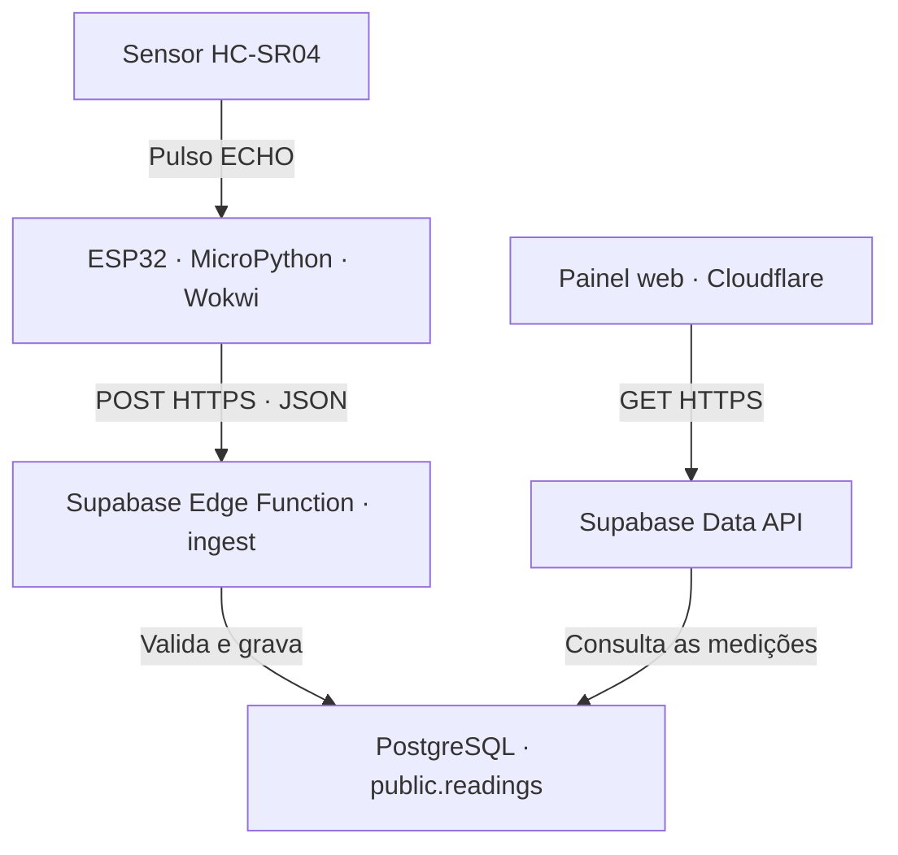

# Monitor de nível de água em reservatório

Projeto acadêmico de Arquitetura de Computadores. O sistema simula um reservatório no Wokwi e apresenta em um painel web o percentual de água, a distância medida pelo sensor e o histórico. O painel alerta quando o nível fica baixo e quando a última medição está desatualizada.

## Links da entrega

| Recurso | Acesso |
| --- | --- |
| Repositório | [GitHub](https://github.com/NathanGSsilva/monitor-reservatorio) |
| Simulação com ESP32 e HC-SR04 | [Wokwi](https://wokwi.com/projects/481525918818220033) |
| Painel publicado | [Cloudflare](https://monitoramento-reservatorio.nathangabrielmine.workers.dev/) |
| Demonstração | [Vídeo no Google Drive](https://drive.google.com/file/d/1iLQGPrwHfTGjxSXAKF7e5inee7laPM7O/view?usp=sharing) |

## Arquitetura



1. O ESP32 dispara o sensor, mede a duração do pulso de retorno e calcula a distância e o nível em porcentagem.
2. O firmware envia a leitura diretamente à Edge Function por HTTPS. A função verifica a chave de envio e valida o JSON antes de gravar.
3. O PostgreSQL registra o horário de recebimento. A gravação acontece mesmo com o painel fechado.
4. O painel consulta a Data API, exibe o nível mais recente e atualiza o gráfico e a tabela automaticamente.

## Arquivos usados na reprodução

| Caminho | Conteúdo |
| --- | --- |
| `wokwi/main.py` | Leitura do sensor, cálculo do nível e envio por HTTPS |
| `wokwi/diagram.json` | Montagem da simulação |
| `wokwi/config.py` | Host da API, identificador do dispositivo e intervalo de coleta |
| `wokwi/ca_cert.py` | Certificado público usado para validar o TLS |
| `supabase/schema.sql` | Tabela, índice e regras de acesso |
| `supabase/config.toml` | Configuração da função `ingest` |
| `supabase/functions/ingest/index.ts` | Recebimento e gravação das leituras |
| `site/index.html` | Painel com HTML, CSS e JavaScript |

## Como reproduzir

Você precisa de uma conta no Supabase, um projeto ESP32 com MicroPython no Wokwi e um navegador. Use o Cloudflare caso queira disponibilizar o painel por um link público.

### 1. Configurar o Supabase

1. Crie um projeto com a **Data API** habilitada.
2. No **SQL Editor**, execute `supabase/schema.sql` uma vez no banco novo. O script cria `public.readings` e habilita a segurança por linha (RLS).
3. Em **Edge Functions**, crie e publique uma função chamada `ingest` usando o conteúdo de `supabase/functions/ingest/index.ts`.
4. Na configuração da função, desative **Verify JWT** conforme `supabase/config.toml`. A própria função autentica o envio pelo cabeçalho `x-ingest-key`.
5. Em **Edge Functions → Secrets**, defina `INGEST_KEY` com um valor aleatório de pelo menos 32 caracteres. Guarde o valor para iniciar a simulação.
6. Em **Settings → API Keys**, copie a chave **Publishable** para configurar o painel. Anote também o domínio do projeto, no formato `<project-ref>.supabase.co`.

A Data API permite a leitura pública das medições simuladas conforme a política do projeto. A escrita passa pela função `ingest`. Mantenha a chave de envio, a senha do banco e as credenciais administrativas fora do GitHub e dos projetos públicos.

### 2. Configurar e testar o Wokwi

1. Abra a simulação pelo link da entrega ou crie um projeto ESP32 com MicroPython e copie os arquivos da pasta `wokwi/`.
2. Confira a montagem do circuito.

   | HC-SR04 | ESP32 no simulador |
   | --- | --- |
   | VCC | 5 V |
   | GND | GND |
   | TRIG | GPIO 12 |
   | ECHO | GPIO 14 |

3. Em `config.py`, defina `API_HOST` com o domínio do Supabase, sem `https://` ou caminho. Use `DEVICE_ID = "reservatorio-01"` e `INTERVALO_MS = 5000`. Mantenha `INGEST_KEY = ""` na cópia compartilhada.
4. Inicie a simulação e informe a chave de envio no monitor serial quando o programa pedir. O ESP32 usa a rede `Wokwi-GUEST` e valida a conexão TLS com o certificado de `ca_cert.py`.
5. Altere a distância no HC-SR04. Aguarde `API HTTP 201` no serial e confira a nova linha em **Table Editor → readings** no Supabase.

A distância em centímetros é estimada dividindo por 58 a duração do pulso ECHO em microssegundos. Para o reservatório simulado, **10 cm** representa cheio e **110 cm**, vazio:

```text
nível (%) = 100 × (110 - distância em cm) / (110 - 10)
```

O resultado fica entre 0 e 100%, com uma casa decimal. Leituras sem eco válido são descartadas.

### 3. Configurar e abrir o painel

1. Em `site/index.html`, ajuste a URL da consulta para o seu projeto em `https://<project-ref>.supabase.co/rest/v1/readings`.
2. Preencha a constante `PUBLIC_KEY` com a chave **Publishable**. Se tiver mudado o identificador no Wokwi, ajuste o filtro `device_id` no painel.
3. Abra o arquivo no navegador. Para reproduzir via servidor local, execute na raiz do projeto:

   ```sh
   python -m http.server 8000 --directory site
   ```

   Acesse [http://localhost:8000](http://localhost:8000).
4. Para hospedar, publique o conteúdo da pasta `site/` como arquivos estáticos no Cloudflare e abra o endereço gerado. O `index.html` fica na raiz da publicação.

O painel consulta até 60 leituras, ordenadas pela data de recebimento. O gráfico usa ordem cronológica e o cartão usa a leitura mais recente. O alerta **Nível baixo** aparece em **20% ou menos**. O aviso **Dados desatualizados** aparece após **mais de 20 segundos** sem uma leitura nova. A consulta periódica continua durante a pausa e o painel volta a mostrar dados recentes quando chega outra medição.

## API e banco de dados

Para registrar uma leitura, o ESP32 envia `POST /functions/v1/ingest` com `Content-Type: application/json` e o cabeçalho `x-ingest-key`. Este é um corpo de teste, sem credenciais:

```json
{
  "device_id": "reservatorio-01",
  "message_id": "teste-001",
  "distance_cm": 95,
  "level_pct": 15
}
```

| Resposta | Significado |
| --- | --- |
| `201 Created` | A medição foi gravada |
| `200 OK` | A combinação de dispositivo e mensagem já havia sido gravada |
| `400 Bad Request` | A leitura é inválida |
| `401 Unauthorized` | A chave de envio é inválida ou está ausente |

A tabela `public.readings` guarda `device_id`, `message_id`, `distance_cm`, `level_pct` e `received_at`. A chave primária composta evita linhas duplicadas e o banco preenche `received_at`. O painel usa `GET /rest/v1/readings` com a chave Publishable no cabeçalho `apikey`, filtrando pelo dispositivo e ordenando por `received_at` em ordem decrescente.

## Como demonstrar

| Teste | Procedimento e resultado esperado |
| --- | --- |
| Nível normal | Ajuste para cerca de **60 cm**. O painel deve indicar aproximadamente **50%**. |
| Nível baixo | Ajuste para cerca de **95 cm**. Confirme o `HTTP 201`, a nova linha no Supabase e o alerta no painel em aproximadamente **15%**. |
| Interrupção | Pare o Wokwi. Após mais de **20 segundos** da última leitura, o painel deve exibir **Dados desatualizados**. |
| Retomada | Reinicie a simulação e informe a chave. Quando uma nova leitura for gravada, o painel deve atualizar sozinho. |
| Painel fechado | Feche o painel e mantenha o Wokwi enviando. Ao reabrir, confira no histórico as leituras gravadas durante esse intervalo. |

## Limitações

O nível é estimado a partir das distâncias definidas na simulação. Nos testes ocorreram falhas intermitentes no Wi-Fi e na negociação TLS. Durante uma interrupção, o painel continua exibindo a última leitura gravada e sinaliza quando ela fica antiga. O firmware tem um intervalo nominal de 5 segundos, que pode aumentar se a conexão demorar.

## Integrantes e contribuições

| Integrante | RA | Contribuição |
| --- | --- | --- |
| Bruno Marcelo Rocha da Silva | 1988442 | Backend e integração do ESP32 com o Supabase |
| Júlia Soares de Azevedo Lombardi | 2032874 | Painel web, visualização das medições e relatório |
| Nathan Gabriel da Silva | 2077558 | Backend e integração do ESP32 com o Supabase |
| Tainá De Souza Alves | 2041631 | Painel web, visualização das medições e relatório |
